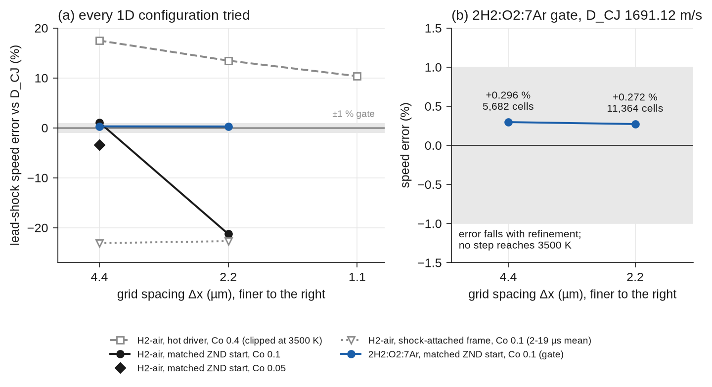
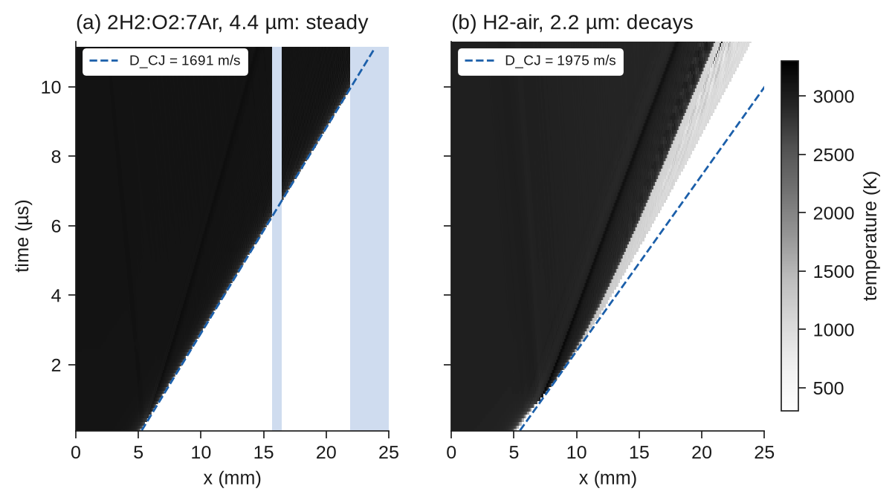
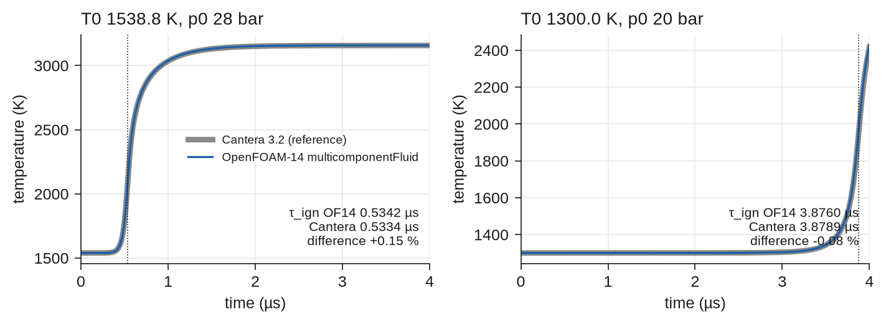
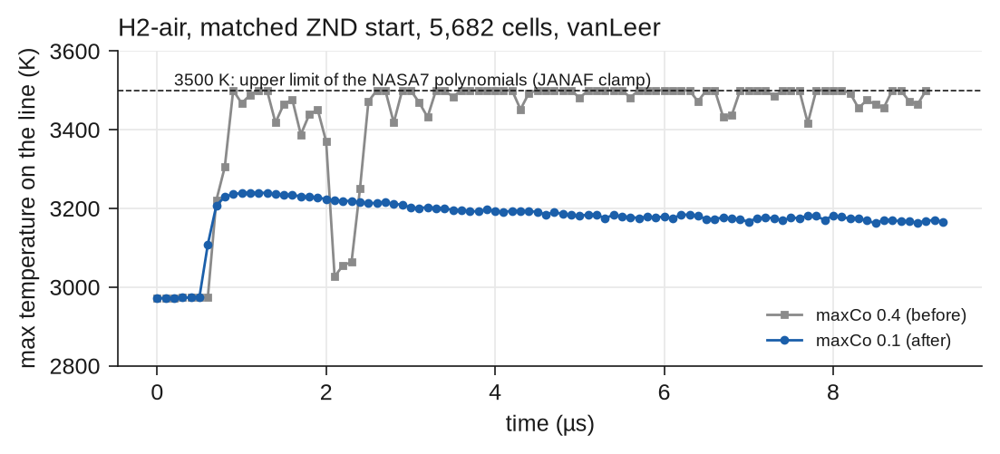
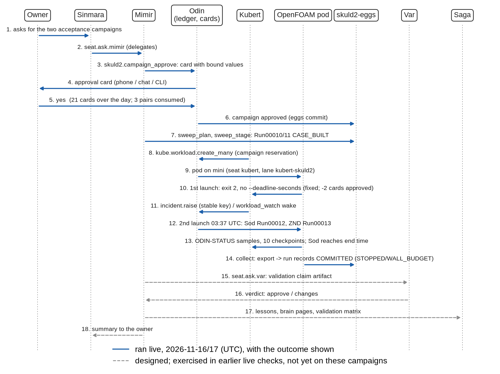

# skuldsubmit: agents that propose, run, check and record detonation simulations

**AM/ME/CE 295 (Agentic AI in Scientific Discovery), Lab Report 3, weeks 5-6.** Colin Gray.

> AI disclaimer: this repository's report, slides, figures, scripts and curation were made by Claude Opus 5.5 (Claude
> Code), from Colin's project records and run data. Every number is read from a file in `data/`.

**skuld2** is an agentic simulation pipeline. Seats (long-lived agents) of Odin, a personal agent harness, propose a
validation campaign, raise an owner approval card, launch OpenFOAM-14 with the detonationFluid module in a k3s pod,
collect the result into a git-backed record (skuld2-eggs) and check it against independent references. Lab 2
studied how an agent supervises long-running pods; Lab 3 points the same supervision layer at simulations, where
"accept" can be checked against a known answer.

- **Report:** [`report/Lab_Report_3_-_Colin_Gray.pdf`](report/Lab_Report_3_-_Colin_Gray.pdf) (also `.docx`)
- **Slides (the demo):** [`slides/Lab3_skuld2_demo.pdf`](slides/Lab3_skuld2_demo.pdf) (also `.pptx`, with speaker notes)
- **Running log:** [`LOG.md`](LOG.md) · **Demo:** [`demo/`](demo/) · **Live timeline:** [`data/agent/TIMELINE-2026-11-16.md`](data/agent/TIMELINE-2026-11-16.md)

## Results

| Check | Result | Criterion | Verdict | Evidence |
|---|---|---|---|---|
| 0D ignition delay, OpenFOAM-14 vs Cantera (Burke 2012), 1538.8 K / 28 bar and 1300 K / 20 bar | +0.15 % / -0.08 % | ≤ 2 % | **pass** | `data/chem0d/`, `code/chem0d/` |
| 1D CJ speed, 2H2:O2:7Ar, 1 atm, 300 K, 5,682 / 11,364 cells | 1696.14 / 1695.72 m/s: **+0.296 / +0.272 %** vs D_CJ 1691.12 m/s; error falls; no clipping | ≤ 1 % on both grids | **pass** | `data/det1d/finish1d-ar7.json` |
| 1D H2-air φ=1, hot driver, Courant 0.4, three grids | +17.47 / +13.46 / +10.35 %, T clipped at 3500 K | ≤ 1 % | fail (setup bug, fixed) | `data/det1d/det1d-three-grid.json` |
| 1D H2-air φ=1, matched ZND start, Courant 0.1 | +1.08 % (4.4 µm), -21.27 % (2.2 µm) | ≤ 1 % | fail | `data/det1d/finish1d-courant.json` |
| 1D H2-air φ=1, shock-attached frame | -23.1 / -22.7 %, grids within 0.4 % | multi-cycle mean | fail: known-unstable, recorded | `data/det1d/finish1d-shockframe-*.json` |
| Sod, shockFluid, 1,000 cells | fan tail off by 1.31 cells | ≤ 1 cell | fail | `data/sod/sod-check.json` |
| Measured cost, detonationFluid, 4 ranks | c = 20.3-22.2 core-µs per cell-step | planning value 200 | measured | `data/cost/` |
| Surrogates: FNO-1D on RDE.jl rings | wave count 99.22 % (test, 129 runs) | smoke test only | recorded | `data/surrogates/` |
| Surrogates: Transolver / MeshGraphNet overfit gate | 0.504, 0.730 / 0.703 | ≤ 0.05 | fail | `data/surrogates/overfit-gate/` |
| Agent loop, Sod acceptance campaign (2026-11-17) | Run00012 COMMITTED via Mimir → card → Kubert's pod → collect; terminal `STOPPED / WALL_BUDGET` | COMPLETED | partial | `data/agent/`, `data/runs/eggs/` |

61 background runs are logged in `data/runs/RUNS.tsv` (28 ok, 31 failed, 2 partial). The failures are kept.

| | |
|---|---|
|  |  |
| Fig. 1: speed error vs grid for every 1D configuration; the argon gate case passes | Fig. 3: temperature x-t; argon rides the CJ line, H2-air falls behind |
|  |  |
| Fig. 2: 0D ignition, OpenFOAM-14 over Cantera | Fig. 7: the 3500 K clip at Courant 0.4, gone at 0.1 |



The live agent loop on 2026-11-16/17 (accent: steps that ran live). More: `figures/` (Sod vs exact, local shock speed,
cost, surrogate gate) and `diagrams/` (system architecture, seat map, validation ladder, data and surrogate pipeline,
Lab 2 → Lab 3).

## Reproduce

Python 3.13 with the pinned `requirements.txt` (Graphviz's `dot` on PATH for the diagrams):

```sh
python -m venv .venv && . .venv/bin/activate && pip install -r requirements.txt
python demo/replay.py                         # one validation run end to end from data/ (~5 s)
python code/chem0d/cantera_ignition.py        # Cantera reference vs OpenFOAM-14 0D ignition (~3 s)
python code/det1d/speed_fit.py data/det1d/probes-*.npz   # lead-shock speed and the 1 % gate
python figures/make_figures.py                # every figure in figures/ from data/
python diagrams/make_diagrams.py              # every diagram in diagrams/
python report/build_report.py && soffice --headless --convert-to pdf --outdir report report/*.docx
python slides/build_slides.py && soffice --headless --convert-to pdf --outdir slides slides/*.pptx
```

**What needs OpenFOAM-14.** Rerunning the solves themselves: OpenFOAM-14 (Foundation, `OpenFOAM/OpenFOAM-14` at
`64cfdf54`) with `detonationFluid` from `TXChris/detonationFoam-OF14` (branch `OF-14`, `09c9bfcd`), plus Cantera and
SDToolbox for the ZND initial condition. The cases are in `code/openfoam/` and the exact run sequence is
`code/det1d/znd-run.sh`; see `code/README.md`. The 5,682-cell argon tube takes about 17 minutes on 4 cores
(1.15 core-hours). Everything else above runs from `data/` without it.

## Layout

| Path | Contents |
|---|---|
| `report/` | Lab Report 3 (`.docx`, `.pdf`) and `build_report.py` |
| `slides/` | the demo deck (`.pptx`, `.pdf`) and `build_slides.py` |
| `demo/` | `replay.py`, its output, and sanitized captures of the live system (`odin view` Missions, pods and logs, Kubert's incidents, approval cards, a committed run record) |
| `figures/` | eight result figures (PDF, SVG, PNG) and `make_figures.py` |
| `diagrams/` | six architecture diagrams (PDF, SVG, PNG) and `make_diagrams.py` |
| `data/` | the evidence: result JSON, raw probe traces, x-t samples, Sod profiles, cost tables, run records, surrogate metrics, approvals, incidents, pod logs (`data/README.md`) |
| `code/` | runnable pieces and curated excerpts with provenance headers: 0D Cantera check, speed fit, ZND initializer, evaluators, OpenFOAM case dictionaries, the Burke 2012 mechanism, skuld2's campaign / run-card schema / template / pod supervisor, one sanitized Odin seat and the supervision interface (`code/README.md`) |
| `LOG.md` | the running log for weeks 5-6 |

## Provenance and scope

This is an allowlisted extract. The simulation harness (skuld2), its records (skuld2-eggs) and the full agent harness
(Odin) are private; the public Odin mirror from Lab 2 is [colingray3149/odin2](https://github.com/colingray3149/odin2).
Registry excerpts drop every line tagged personal; captures show only seat, mission and pod views; host addresses and
identifiers are removed.

## References

OpenFOAM-14 (openfoam.org); Weller et al. 1998; Sun et al., detonationFoam, Comput. Phys. Commun. 2023
(doi:10.1016/j.cpc.2023.108859) and its OF-14 port; Burke et al., Int. J. Chem. Kinet. 44:444 (2012),
doi:10.1002/kin.20603; Cantera 3.2 (cantera.org); SDToolbox, GALCIT FM2018.001 (Shepherd group, Caltech); Kwak et al.,
arXiv:2508.16105; Zangene et al., arXiv:2410.17561; Liu, arXiv:2509.19808; Sankar et al., OpenFOAM J. 4 (2024),
doi:10.51560/ofj.v4.125; Toro, *Riemann Solvers and Numerical Methods for Fluid Dynamics*; REALM, arXiv:2512.18595;
FNO, arXiv:2010.08895; Transolver, arXiv:2402.02366; MeshGraphNet, arXiv:2010.03409; DoMINO, arXiv:2501.13350;
NVIDIA PhysicsNeMo 2.2.2; Koch et al., arXiv:1908.03116; RDE.jl, doi:10.5281/zenodo.19494530. Full list in the report.

## Licence

Code: MIT (`LICENSE`). `code/mechanism/Burke2012.yaml` is SDToolbox's data file under its own licence
(`code/mechanism/SDToolbox-LICENCE.txt`). OpenFOAM case dictionaries follow OpenFOAM's GPL-3.0 headers.
